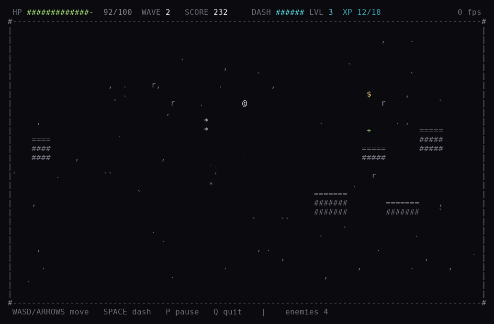
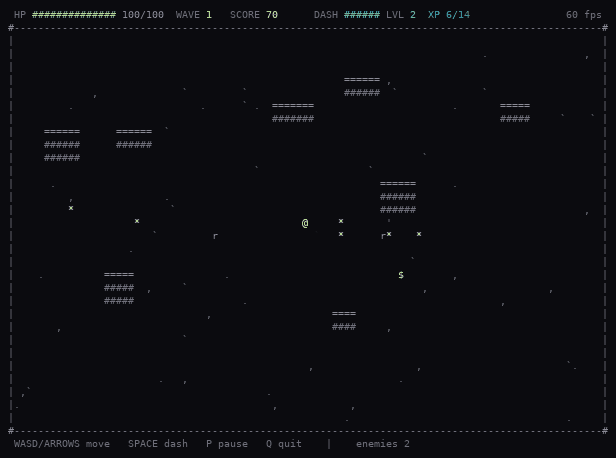

# ASCII ARENA

A top-down survival arena shooter rendered entirely with ASCII characters in the
Windows console. You are `@`, the arena fills with enemies in escalating waves,
and everything - player, enemies, bullets, cover, pickups, HUD - is drawn with
characters on a 100x34 character grid.

Built as a C++17 console project: no external libraries, no assets, one
executable.



Recorded playthrough (12 s, seeded demo run):



## Requirements

| | |
|---|---|
| OS | Windows 10/11 (also builds on Linux/macOS terminals) |
| Compiler | MSVC 2019/2022 (`/std:c++17`) or MinGW-w64 g++ 8+ |
| Build tool | **none needed**: `build.bat` finds your compiler itself (CMake optional) |
| Console | at least 60x22 characters; **100x34 recommended** |

## Build

### Fastest: one command, no CMake

```bat
build.bat
```

`build.bat` looks for `cl.exe` on PATH, then for a Visual Studio installation via
vswhere and loads its environment automatically, then falls back to `g++` /
`clang++`. It builds `build\ascii_arena.exe` and needs no Developer Command
Prompt.

No compiler installed at all? Either grab the prebuilt `ascii_arena.exe` from
[Releases](https://github.com/zanni098/ascii-arena-cpp/releases), or install the
free build tools (per-user, no admin rights):

```bat
winget install --id Microsoft.VisualStudio.2022.BuildTools -e
```

### Option A - CMake (Visual Studio)

```bat
cmake -S . -B build -DCMAKE_BUILD_TYPE=Release
cmake --build build --config Release
build\Release\ascii_arena.exe
```

Visual Studio users can also use *File > Open > Folder...* on this directory:
VS picks up `CMakeLists.txt` automatically and gives you a full debugging
experience (breakpoints, watch, call stack).

### Option B - x64 Native Tools Command Prompt

If you already have that prompt open, `build.bat` uses the compiler on PATH
directly:

```bat
build.bat
```

### Option C - MinGW-w64 / Linux

```bash
g++ -std=c++17 -O2 -Wall -Wextra -Isrc src/main.cpp src/core/*.cpp src/game/*.cpp -o ascii_arena
```

On Linux/macOS the same binary runs inside any ANSI terminal (the POSIX branch
of `src/core/Platform.cpp` uses raw `termios` input).

## Controls

| Key | Action |
|---|---|
| `W` `A` `S` `D` / arrow keys | move |
| `SPACE` | dash (short burst of speed + brief invulnerability) |
| `1` `2` `3` or `ENTER` | pick a level-up upgrade |
| `P` / `ESC` | pause |
| `Q` | quit to menu (abandons the run) |
| `R` | retry after game over |

Shooting is automatic: `@` fires at the nearest enemy, so the whole game can be
played with movement keys only.

## How the game works

* **Waves** - each wave spawns more and tougher enemies. A wave ends when the
  arena is cleared, or after a 34 second time limit so a straggler can never
  stall the run.
* **Enemies**
  * `r` rusher - fast, chases directly, weaves to be harder to hit
  * `s` spitter - keeps its distance and fires `o` projectiles
  * `B` brute - slow, high health, heavy contact damage
  * `W` warden - boss on every 5th wave: radial volleys plus a telegraphed charge
* **Cover** - `#` blocks generated fresh every run. They stop movement and
  bullets, so they double as a tactical resource.
* **Pickups** - `+` heals, `$` scores bonus points.
* **Levels** - kills grant XP; each level offers a choice of three upgrades
  (fire rate, damage, piercing, speed, max HP, extra projectiles, faster dash,
  repair).
* **High scores** - the top 8 runs are stored in `highscores.txt` with your
  three letters.

## Files created at runtime

| File | Purpose |
|---|---|
| `config.cfg` | tuning values, written with defaults on first launch |
| `highscores.txt` | persistent top-8 table |

Both live next to the executable (the working directory).

## Tuning without recompiling

Edit `config.cfg`:

```ini
# ASCII ARENA - runtime configuration
arena_width=100          # console columns (including walls)
arena_height=34          # console rows (including HUD and footer)
target_fps=60
player_speed=16          # cells per second
start_fire_interval=0.42 # seconds between shots
start_damage=10
difficulty_scale=1.0     # >1 = tougher, <1 = easier
seed=0                   # 0 = random every run
show_fps=1
```

## Command line

```
ascii_arena --help
ascii_arena --width 120 --height 40 --difficulty 1.3
ascii_arena --seed 12345           # reproducible run
ascii_arena --demo 60 --dump shots # headless simulation, writes ASCII frames
ascii_arena --screens docs_shots   # one frame of every screen
```

`--demo` runs the simulation with a scripted kiting bot and no rendering, which
is what the automated checks use. `--screens` writes a text and ANSI-coloured
frame of the menu, gameplay, pause, level-up and game-over screens - handy for
a report appendix.

## Project layout

```
ascii_arena/
  CMakeLists.txt          build definition
  build.bat               one-line MSVC build
  config.cfg              default tuning (regenerated if deleted)
  src/
    main.cpp              argument parsing, startup
    core/
      Platform.h/.cpp     console setup, non-blocking input, double buffered output
      Canvas.h/.cpp       ASCII draw surface with clipping, ANSI/text export
      Math.h              Vec2 helpers
      Rng.h               deterministic xorshift generator
      ObjectPool.h        fixed-capacity recycling pool (template)
      Config.h/.cpp       key=value config file parser
    game/
      Entity.h/.cpp       abstract entity base
      Player.h/.cpp       movement, dash, auto-aimed shooting
      Enemy.h/.cpp        Enemy base + Rusher/Spitter/Brute/Boss + factory
      Projectile.h/.cpp   bullets
      Pickup.h/.cpp       heal / score drops
      Particle.h/.cpp     pooled ASCII sparks
      World.h/.cpp        simulation owner: entities, collisions, cover, score
      WaveDirector.h/.cpp spawn scheduling and difficulty ramp
      Upgrades.h/.cpp     level-up pool and effects
      Hud.h/.cpp          status bar, boss bar, banner, footer
      Scoreboard.h/.cpp   persistent top-8 table
      States.h/.cpp       menu / play / pause / upgrade / game over
      Game.h/.cpp         fixed timestep loop, layout, state switching
  tools/render_frames.py  turns `--screens` output into PNGs for documentation
```

Architecture, class diagrams and the mapping of C++ concepts to files are in
[DESIGN.md](DESIGN.md).

## Automated checks

```bash
# headless: builds, then two identical seeded runs must match
bash tests/smoke_test.sh

# end-to-end: drives the real binary through a pty (menu -> play -> pause -> quit)
python3 tests/interactive_test.py

# 90 seconds of deterministic simulation (score, wave, kills, no crash)
./ascii_arena --demo 90 --seed 12345

# same binary compiled with AddressSanitizer + UndefinedBehaviorSanitizer
g++ -std=c++17 -g -fsanitize=address,undefined -Isrc src/main.cpp src/core/*.cpp src/game/*.cpp -o asan
./asan --demo 120 --seed 99
```

The interactive test needs a POSIX pty (Linux/macOS); the headless and sanitizer
checks run anywhere.

The demo prints a one-line summary such as:

```
[demo] time=89.90s score=1045 wave=5 level=7 kills=58 hp=36 enemies=4 projectiles=29 particles=7 frames=0
```

## Troubleshooting

* **"Window too small"** - resize the console (or set `arena_width` /
  `arena_height` in `config.cfg` to what your window can show). 100x34 is the
  sweet spot.
* **Garbled frame** - the Windows build writes Unicode cells directly, so no
  code page setup is needed; make sure the window is not resized while playing
  (the game adapts on next launch).
* **No input** - click inside the console window once so it has keyboard focus.
